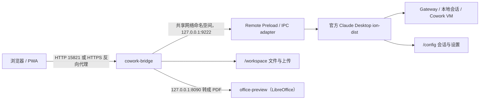

# Claude Desktop Server

在 Linux 服务器上以无头 Docker 容器运行 Anthropic 官方 Linux Claude Desktop，并通过轻量级 Remote IPC Bridge 在浏览器中使用 Chat、Cowork 与可选的 Code/Developer 能力。浏览器看到的是 Claude Desktop 随安装包提供的官方 `ion-dist` 界面；本项目只负责容器化、受限桥接和持久化，不重做消息渲染器。

> **Eva Mode。** 本仓库的 `main` 是多用户形态：认证与账户优先（`authd` 服务），每个用户一个由 systemd
> 托管的轻量实例，界面是合并后的 Cowork 单一表面。账户即**租户**：其容器权限很高（`CAP_SYS_ADMIN`、
> `userns_mode: host`、`apparmor=unconfined`，`app` 用户免密 `sudo`），因此 Code 绝不在租户容器内运行，
> 而是跑在其 Cowork 访客机里的自建 runner 上；详见 [Code 在 Cowork VM 中运行](docs/code-in-cowork-vm.md)。
> 单用户部署保留在 `maddie` 分支。部署步骤、反向代理配置与 Stage 2 设计见 [Eva Mode](docs/eva-mode.md)。

## 界面预览

### PC 端

<p align="center">
  
</p>

<p align="center">
  
</p>

### 移动端

<p align="center">
  
  
  
</p>

## 适用场景

- 在 Linux 服务器上运行官方 Claude Desktop，而不依赖物理桌面。
- 使用局域网或 Tailnet 浏览器访问 Chat 与 Cowork，并保留 Desktop 的本地会话状态。
- 在可信 HTTPS/Authelia 入口后按需打开 Gateway 设置、Developer、Infrastructure 或 Code 表面。
- 让同一份 `/config` 和 `/workspace` 数据在容器重启后继续可用。

## 工作原理



关键边界：

- `claude-desktop` 运行官方签名 APT 包、Electron/Xvfb 和 Cowork VM。
- `cowork-bridge` 只发布浏览器所需的 HTTP API；三个服务共享 `claude-desktop` 的网络命名空间。
- `office-preview` 是无状态转换器：只接收 POST 上来的字节并返回 PDF，不挂载 `/workspace` 或 `/config`；它单独成容器，避免一次重量级转换拖垮同时服务 Chat/Cowork IPC 的 Bridge。
- Bridge 到 Desktop 的方法、路径、文件类型和请求头均采用 allowlist；不接受任意 Electron action 或任意文件路径。
- Chat 与 Cowork 使用同一官方 `LocalAgentModeSessions` 管理器，但按 `sessionType` 隔离；事件通过 `GET /api/events?mode=chat|cowork&sessionId=:id` 推送。

## 浏览器入口

| 入口 | 用途 | 访问边界 |
| --- | --- | --- |
| `https://claude-home.172906573.xyz:28443/` | 使用 WebUI、安装 PWA、跨网络访问 | 由现有 Nginx Proxy Manager + Authelia 保护 |

WebUI（`15821`）与移动端（`8081`）端口只绑定宿主机回环地址（`127.0.0.1`），不直接暴露到网络：
入口应经反向代理（TLS + Authelia）。租户实例（`CLAUDESK_TENANT=1`）还会在 Bridge
自身校验 authd 会话并把账户限定为 `CLAUDE_REMOTE_ACCOUNT_EMAIL`；移动端使用每账户的
`CLAUDESK_BRIDGE_TOKEN`。网络层同样隔离租户：数据容器只接入本栈自己的网络，共享网络
上只有固定用途的中继（见 `SECURITY.md` 的 "Network isolation"）。HTTPS 入口需要把主机名
解析到服务器，并沿用现有 Authelia 两因素规则。标准 PWA 安装需要 HTTPS。

## 前置条件

- Linux 主机、Docker Engine 与 Docker Compose v2。
- 可用的 `/dev/kvm` 与 `/dev/vhost-vsock`，并允许当前用户访问 KVM 组。
- 两个外部 Docker 网络：`gateway_net`（共享网关、authd 与每个账户的出口中继）和
  `claudesk-control`（authd 与每个账户的控制面中继；租户数据容器不接入）：

  ```bash
  docker network inspect gateway_net >/dev/null 2>&1 || \
    docker network create gateway_net
  docker network inspect claudesk-control >/dev/null 2>&1 || \
    docker network create claudesk-control
  ```

- 可访问 Anthropic 官方 APT 源；首次构建会编译校验固定版本的 `virtiofsd` 1.13.3。
- Gateway 的 URL、API Key、认证方案和模型列表。
- 为 Cowork VM 与持久化数据预留约 25 GB 以上空间。

## 快速开始

```bash
git clone https://github.com/ump45nose/Claudesk.git
cd Claudesk
cp .env.example .env
```

编辑 `.env`，至少填写以下三项（不要把真实密钥提交到 Git）：

```dotenv
CLAUDE_GATEWAY_BASE_URL=http://gateway.example:3001
CLAUDE_GATEWAY_API_KEY=请填入你的密钥
CLAUDE_INFERENCE_MODELS_JSON='[{"name":"claude-sonnet-minimax-m3","labelOverride":"MiniMax M3","anthropicFamilyTier":"sonnet","isFamilyDefault":true}]'
```

准备 seccomp 配置、构建并启动：

```bash
./scripts/prepare-seccomp.sh
./deploy.sh
./scripts/smoke.sh
```

`deploy.sh` 构建并强制重建本部署的全部服务。网关链（`compose.gateway.yaml`：缓存代理 `shitproxy` 与
caddy `gateway`）是**主机级基础设施**，每台机器只启动一次，不随部署启动——这样同一台机器上可以同时跑
多个部署。等价的命令是：

```bash
# 每台主机一次（网关链；其中的镜像 local/shitproxy 由独立项目构建，不在本仓库）
sudo docker compose -f compose.gateway.yaml up -d

# 每次部署
sudo docker compose -f compose.yaml up -d --build --force-recreate \
    claude-desktop cowork-bridge claude-gateway-loopback \
    claude-mobile claude-mobile-gateway-loopback authd \
    gateway-egress authd-egress internal-ingress
```

查看状态或停止：

```bash
sudo docker compose -f compose.yaml ps
sudo docker compose -f compose.yaml logs -f claude-desktop cowork-bridge
sudo docker compose -f compose.yaml down
```

镜像固定安装 `CLAUDE_DESKTOP_VERSION` 指定的精确版本，容器重启不会执行 APT 升级。生产机使用
`ops/systemd/claudesk-monthly-update.timer` 在每月 1 日 04:30（Asia/Taipei）构建候选镜像；
只有当前单版本 Renderer 补丁准备和基本冒烟通过后才切换，失败会保留或恢复上一镜像。

## Desktop 2.x 升级

当前固定版本为 **2.9939.4**（2026-10-01 检查官方 stable APT 仓库）。升级已有部署时，
将本机 `.env` 的 `CLAUDE_DESKTOP_VERSION` 改为 `2.9939.4`，确保
`CLAUDE_COWORK_HOST_BASH=0`，然后重新构建并运行现有 smoke scripts。
Desktop 2.x 使用官方原生编辑、rewind 与问题处理；旧版 1.x 的编译代码补丁已移除。
可选 container-host Bash 模式尚不支持 2.x，会在修改安装包前明确拒绝启动。
请在更新前停止 Desktop 并备份持久化 `/config`；新版本可能迁移会话数据。

可在不启动 Electron 的情况下检查官方包的 renderer：

```bash
npm ci --prefix rootfs/opt/claude-cowork-bridge --ignore-scripts
node scripts/desktop-compatibility-smoke.mjs /path/to/extracted/resources/ion-dist
```

该检查覆盖默认模式和 Gateway 设置开关、生成模块语法和包版本边界。
它不能替代 Linux/KVM 主机上的 Chat、Cowork 与实际 Gateway 端到端验证。

### 更新韧性

每月检查只会部署 `config/release.json` 声明的已审查版本。发现更高版本时记录
`awaiting-compatibility-profile` 并保留当前服务；构建参数不能覆盖兼容性声明。
维护者升级时必须检查新官方包、更新版本声明，并运行 compatibility 与 smoke 检查。
包入口与 renderer 使用同一版本声明。Frontend 补丁使用 Acorn AST 按协议比较、
路由跳转和稳定属性识别目标，不依赖 chunk 文件名、局部变量名、空白或引号风格。
只替换必要表达式，保留其他 bundle 字节及模块图；缺失或重复目标会明确拒绝。
原生能力检查也使用语法结构，避免仅因 IME 等表达式重新编译而误判功能缺失。
详见 [Frontend 补丁维护](docs/frontend-patches.md)。

Renderer 在验证全部目标后才发布生成文件，并最后原子更新 manifest 指针；验证失败保留旧文件。
候选检查沿用部署的 Gateway 开关。Desktop 和 bridge 一起构建、切换和恢复；恢复使用
正在运行的原始 image ID，失败或中断触发恢复，恢复失败记录 `rollback-failed`。
镜像恢复不撤销官方程序对持久化会话数据的迁移，升级前仍需备份 `/config`。

`scripts/validate.sh` 包含编译变量漂移、缺失/重复目标、旧 renderer 保留及模拟更新失败测试。
这些测试使用临时目录和模拟 Docker，不修改真实部署；真实 Electron/KVM 验证仍需生产同类主机。

## 配置项

### 必填与基础运行

| 变量 | 默认值 | 说明 |
| --- | --- | --- |
| `COWORK_WEB_PORT` | `15821` | 宿主机公开端口，映射到 Bridge `8080` |
| `COWORK_BRIDGE_INTERNAL_PORT` | `9222` | Desktop 内部 Cowork adapter 端口，仅 loopback |
| `COWORK_UPLOAD_MAX_BYTES` | `1073741824` | Web UI 单次上传（附件、拖入文件夹）的总大小上限，字节数，可带 `K`/`M`/`G` 后缀；文件以原始二进制流式写入 `/workspace/RemoteUploads`，不占内存 |
| `COWORK_REMOTE_READ_ROOTS` | —（仅 `/workspace`） | 已认证的远程下载路由（`GET /api/remote/files/download`）额外可读的根目录，冒号或逗号分隔；`/workspace` 始终允许。路径在 cowork-bridge 容器内解析，宿主机目录还需 bind mount 进容器才可见。列出的路径即可被远程读取，务必配合已认证的 HTTPS 入口 |
| `COWORK_REMOTE_SESSION_OUTPUTS_ROOT` | `/config/.config/Claude-3p/local-agent-mode-sessions` | Cowork 会话自己的 `outputs/` 目录也允许下载与预览：交付物写在 Desktop 的 userData 下（不在 `/workspace`），模型的文件卡片直接链接到它们，Desktop 自身的文件访问同意规则同样把该目录视为会话的一部分。同一棵树下的 `memory`、会话记录和设置仍然不可读。一般无需修改 |
| `COWORK_REMOTE_SESSION_FILE_MAX_BYTES` | `10485760` | 文件面板回退读取的大小上限：Desktop 自身的会话读取器对会话目录之外或超过 10 MiB 的文件返回 null（面板显示“Couldn't read this file”），Bridge 改为从上面的可读根目录重新读取；此值即该回退的上限。可写纯字节数或 `K`/`M`/`G` 后缀（如 `100M`）。响应组装期间文件会被同时持有数份，因此 Bridge 另按容器内存上限的八分之一、最多 32 MiB 收紧；超过有效上限的文件在面板中显示为“Preview isn't available”。要真正提高上限也需同时提高 `CLAUDE_COWORK_BRIDGE_MEMORY_LIMIT`。默认与 Desktop 一致 |
| `COWORK_REMOTE_PREVIEW_MAX_BYTES` | `52428800` | 浏览器文件面板预览（`GET /api/remote/files/preview`）允许转换的最大 Office 文档大小，字节数，可带 `K`/`M`/`G` 后缀；默认 50 MiB，与 Desktop 自身的预览上限一致。与文件回退读取一样，Bridge 另按容器内存上限的八分之一、最多 32 MiB 收紧；要真正提高上限需同时提高 `CLAUDE_COWORK_BRIDGE_MEMORY_LIMIT`。PDF 直接透传，不受此值限制 |
| `COWORK_BRIDGE_STATE_DIR` | `/data` | 浏览器通知的可变状态目录：Web Push 订阅、绑定的 VAPID 密钥、设置面板写下的通知偏好。compose 已挂载 `bridge-data` 卷到此目录（宿主机目录需可由 `PUID:PGID` 写入；不可写时推送订阅不能跨重启保留，退化为页面内通知）。 |
| `CLAUDE_REMOTE_PUSH_SUBJECT` | `mailto:claudesk@localhost` | Web Push 的 VAPID 令牌里给推送服务看的联系方式（`mailto:` 地址或本部署的 `https:` URL）。 |
| `CLAUDE_OFFICE_PREVIEW_MEMORY_LIMIT` | `1g` | `office-preview` sidecar 的内存上限；LibreOffice 转换需要数百 MB，独立于 Bridge 自身的内存上限 |
| `CLAUDE_DESKTOP_VERSION` | `2.9939.4` | 构建时固定安装的官方 Desktop 精确版本 |
| `CLAUDE_GATEWAY_BASE_URL` | — | Gateway origin；通常不要附加 `/v1` |
| `CLAUDE_GATEWAY_API_KEY` | — | Gateway 凭据，仅写入 `.env`/受管配置 |
| `CLAUDE_GATEWAY_AUTH_SCHEME` | `bearer` | Gateway 认证方案 |
| `CLAUDE_INFERENCE_MODELS_JSON` | — | Desktop 接受的精确模型 ID JSON 数组 |
| `CLAUDE_MODEL_PICKER_MAIN_MODELS` | — | 固定在选择器根部的模型 ID（逗号分隔或 JSON 数组），其余模型收进 “More models” 子菜单；在带 `AUTH_IDENTITY_URL` 的部署里只作兜底，通常改由 `/admin/models` 设置 |
| `CLAUDE_CONFIGURED_MODEL` | — | 配置健康检查所探测的模型 ID；Desktop 未指定时会自行挑选名单里名字含 haiku/sonnet/opus 的最短条目，Gateway 不提供该路由时每个页面都报 “Configured model not available”。带 `AUTH_IDENTITY_URL` 的部署通常改由 `/admin/models` 的 “Configured model” 设置；此处仅作兜底 |
| `CLAUDE_HEADLESS` | `1` | 无头启动官方 Desktop |
| `CLAUDE_DISABLE_GPU` | `1` | 服务器环境默认关闭 GPU |

### 远程能力开关

以下能力默认关闭；打开前必须确认入口已由可信 HTTPS/Authelia 或可信 LAN/Tailnet 保护：

| 变量 | 默认值 | 打开后提供 |
| --- | --- | --- |
| `CLAUDE_REMOTE_GATEWAY_SETTINGS` | `0` | 官方第三方推理配置编辑器与 Developer 菜单入口 |
| `CLAUDE_REMOTE_DEVELOPER_ACTIONS` | `0` | MCP/Skill/Plugin 管理、日志/配置查看、调试与 trace/heap 下载等 allowlist 操作 |
| `CLAUDE_REMOTE_INFRASTRUCTURE_ACTIONS` | `0` | Projects/Spaces、Artifacts、Memory 等官方 mutation IPC（Scheduled Tasks 不属于此，始终可用） |
| `CLAUDE_REMOTE_CODE_ACTIONS` | `1` | Code/LocalSessions、终端、权限、MCP 与 `/workspace` 文件操作 |

Code 命令只在 Desktop 容器内执行，默认工作根目录是挂载的 `/workspace`，不会在访问页面的手机或电脑上执行。即使启用高权限开关，Bridge 也不公开远程控制、SSH、云端 teleport、PR mutation 或自动 commit/stash/discard 等方法。

### 界面显示

`CLAUDE_REMOTE_USER_NAME` 设置远程 WebUI 显示的用户名：侧栏用户菜单的标识，以及首页问候语里的称呼
（如 “Back at it, Ada”）。两处按同一规则解析：优先用它，其次用界面其他地方显示的同一个用户名
（Desktop 上报的 OS 用户，与侧栏一致，本镜像里是容器应用用户 `app`），再次才是账号自带的名字。

官方首页问候语由服务端下发 `personalized_greeting` 数据，而不是渲染器内的本地文案；当前 Gateway 不提供
它，渲染器便一直显示官方的 “You’re here!” 占位。Bridge 在响应未携带 `personalized_greeting` 时补上官方
同结构的数据：`chat` 与 `code` 两个 surface，各自按星期几区分时段（`days`，某天缺省时回落到
`default_slots`），再由渲染器按访问者本地时间挑选；其中的 `{{ NAME }}` 占位符与官方后端一样在服务端展开。
Gateway 自行下发的问候语不会被覆盖。

### 资源与网络

`CLAUDE_COWORK_VM_MEMORY_GB`、`CLAUDE_COWORK_VM_CPU_COUNT`、`CLAUDE_COWORK_VM_IDLE_MINUTES` 和 `CLAUDE_COWORK_VM_SCHEDULE_GUARD_MINUTES` 控制 Cowork VM 资源与空闲回收；生产默认值分别为 `2`、`1`、`30`、`10`。`CLAUDE_DESKTOP_MEMORY_LIMIT` 和 `CLAUDE_COWORK_BRIDGE_MEMORY_LIMIT` 默认分别为 `3g` 与 `256m`。

`CLAUDE_EGRESS_ALLOWED_HOSTS_JSON` 可限制 Cowork、Code 和 Plugin CLI 的出站目标。空值不额外放宽策略；`["*"]` 表示交给服务器防火墙与上游网络控制的 unrestricted egress。

## 官方远程接口

### 通用官方界面

- `POST /api/remote/ipc`：调用受限的 `claude.web` 方法。
- `POST /api/remote/store`：读写经过字段过滤的 Desktop store。
- `POST /api/remote/settings`：Gateway 编辑器桥接（需显式打开）。
- `GET|PUT /api/account_profile`：受限的账户资料/指令设置。
- `PATCH /api/account/settings`：仅接受 `code_default_transcript_view`（`normal|thinking|verbose`），用于 Code 选项里的“Default transcript view”。
- `/api/bootstrap` 及选定的组织协议路由：转发官方启动请求。

### 服务器工作目录选择

Cowork 与 Code 的 `FileSystem.browseFolder` / `browseFolders` 现在打开网页内的服务器目录选择器，
浏览挂载的 `/workspace`，支持子目录、空目录、多选与取消，返回服务器绝对路径。
它不再上传访问者电脑上的整个目录，也不把所有选择固定为 `/workspace`。
普通文件附件仍使用浏览器文件选择与上传。

`GET /api/remote/folders?path=...` 只列出工作区内的文件夹；拒绝越界路径和指向工作区外的符号链接。
目录确认前再次检查服务器路径。官方 bundle 内确实包含 SSH `FolderBrowserModal`，
但该组件依赖官方 React Query / Intl 环境，当前没有从任意 Cowork/Code 页面调用它的公共入口。
此实现通过 preload 替换现有选目录 API，不新增 frontend bundle 补丁，保留官方信任确认与会话处理。

选择器还带有“New folder”：`POST /api/remote/folders`（`{path, name}`）在与列表相同的
工作区限制下创建单个目录段，重名返回 409，越界或非法文件名返回 400/403。

Cowork 自身的“Choose folder”授权卡（`mcp__cowork__request_cowork_directory` 工具以及
“add a folder to this session”等流程）不走上面的 preload IPC：Desktop 主进程直接调用
`electron.dialog.showOpenDialog({properties:["openDirectory","createDirectory"]})`。容器里的原生
对话框只画在无人查看的 headless 显示器上，所以按钮看起来毫无反应。开启 web shell 时
（`CLAUDE_REMOTE_FOLDER_PICKER` 默认跟随 `CLAUDE_REMOTE_WEB_SHELL`），wrapper 会把这类目录
对话框改道到浏览器：请求经事件队列送达 preload，由同一个网页选择器作答，再把所选路径回传到
`POST /api/remote/folder-pick`，包装成原生对话框结果 `{canceled, filePaths}` 交给主进程继续挂载。
路径仍会通过官方校验（必须是允许范围内的真实目录），无人作答时超时当作取消。

### 文件面板下载

点击消息中的文件路径会打开官方文件面板。文件面板顶栏在“Files settings”左侧新增一个官方样式的下载图标
（复用官方按钮与 `Download` 图标），点击后在新标签页从 `GET /api/remote/files/download?path=...` 流式下载该文件的原始字节，
因此二进制文件（如 `.ipa`）不会被官方面板读取器的 UTF-8 文本转换破坏；下载失败也不会替换当前页面。
当文件路径是相对路径（如 `folder/file.zip`）时，该路由会在允许的读取根目录（`/workspace` 及额外根目录）内解析它，
而不是相对 Bridge 进程的当前目录。
该按钮由前端补丁注入，选择器只定位文件面板的顶栏动作片段，始终启用且只匹配一次；详见
[Frontend 补丁维护](docs/frontend-patches.md)。面板自身的“Download file”菜单仍按官方行为保留。

### 文件面板预览（Office、PDF、HTML 与 SVG）

官方文件面板的富预览由 Desktop 主进程渲染：Office 文件在 Cowork VM 内调用 LibreOffice（`soffice`）转成 PDF，
再放进一个贴在其自身窗口上的原生 Electron 视图显示；浏览器永远不会合成这个视图，所以远程面板里 `.docx`、`.pptx`、
`.xlsx`、`.pdf`、`.html`、`.svg` 等一直是空白（`CoworkFilePreview.show` 返回成功，但没有任何可见内容）。

现在改为在浏览器内渲染：前端补丁把文件面板预览组件的输出替换为一个指向
`GET /api/remote/files/preview?path=...` 的 `<iframe>`。Office 文档由 `office-preview` sidecar 用 LibreOffice
转换（与 Desktop 同一引擎，因此观感一致）后以 PDF 返回，PDF 直接透传；`.html`/`.htm`/`.svg` 则按原字节内联返回
（`text/html` / `image/svg+xml`），由浏览器自己渲染。
只有 `.pdf`/`.docx`/`.doc`/`.pptx`/`.ppt`/`.xlsx`/`.xls`/`.html`/`.htm`/`.svg` 会切到 iframe，其它文件保留官方原生行为。
Office/PDF 的 iframe URL 末尾附加 `#toolbar=0`（Chrome 内置 PDF 阅读器支持的 PDF 打开参数），隐藏浏览器自带的 PDF 工具栏，
面板里只显示文档本身，也去掉了阅读器自带的下载按钮（它会把转换结果存成 `xxx.docx.pdf`）；
Firefox 与 Safari 忽略该参数，照常显示各自阅读器的界面。
HTML/SVG 的 iframe 带 `sandbox`（`allow-scripts allow-forms allow-modals allow-popups allow-downloads`，
但**不含** `allow-same-origin`），脚本可以运行，但文档处于不透明源（opaque origin），无法调用同源的
`/api/remote/*` IPC；预览路由也对响应重复同样的 CSP `sandbox`，即使用户直接打开预览 URL 也不会获得 Bridge 的源。
同时 preload 不再转发 `CoworkFilePreview` 的原生调用，避免 Desktop 再建一个原生视图、再跑一次 VM 转换。
转换结果按内容哈希缓存；路径解析复用下载路由的读取根目录与包含规则，预览无法触达下载也读不到的文件。

如果文件面板的 iframe 仍显示空白，或反向代理下出现 `frame-ancestors` 拒绝，请检查代理没有覆盖或剥离预览路由的
`Content-Security-Policy`：应用与预览同源，`frame-ancestors 'self'` 已足够；不要添加 `X-Frame-Options: DENY`
（`SAMEORIGIN` 可以）。代理也不应把 `/api/remote/files/preview` 重定向到登录页——iframe 会带着已登录的 Cookie
请求它。若在代理上另加 CSP，请保留 `frame-ancestors 'self'`（或显式列出你的访问源）。

保真度要点：Office 转换使用与 Desktop 相同的 LibreOffice，并安装 Calibri/Cambria 的等宽替代字体（Carlito/Caladea），
尽量保持分页一致；`.xlsx`/`.xls` 采用与 Desktop 相同的“每个工作表一页”导出。大文件超过
`COWORK_REMOTE_PREVIEW_MAX_BYTES` 时拒绝转换（HTML/SVG 为流式透传，不受此上限约束）。补丁改动会同步
`patchRelease`，让不可变的渲染器资源 URL 重新加载。

### 文件读取授权（File Access Request）

Desktop 主进程在读取“不属于该会话自己的目录”的文件前会先问使用者一句：`checkFileAccessConsent`（main bundle）放行会话的
`outputs` 目录、会话被授予的文件夹、以及此前已批准过的路径；其余读取——文件面板加载预览文本用的 `FileSystem.readLocalFile`、
记忆编辑器打开 `CLAUDE.md` 用的同一条 IPC——都会先弹出原生卡片：

```js
dialog.showMessageBox(window, {
  title: "File Access Request",
  message: "Allow Claude to preview this file?",
  detail: "<path>\n\nThis will allow Claude to preview the file.",
});
```

agent 记忆文件正是这类路径：它位于 Desktop 自己的 userData 下（`~/.config/Claude-3p/local-agent-mode-sessions/…/memory/`），
不属于任何会话被授予的文件夹（尽管读取器自己的白名单 `getAutoMemoryDir` 覆盖了它）。于是从浏览器打开记忆文件（文件面板预览、
记忆编辑器）会把这张卡片画在无人观看的显示器上，渲染进程的 `ipcRenderer.invoke` 永不落定：`showMessageBox` 不 resolve，
Bridge 的 `/api/remote/ipc` 请求也就永远不返回，面板一直转圈——表现为“永远挂住”，既不出错也不超时。

`CLAUDE_REMOTE_FILE_CONSENT` 默认开启时，wrapper 直接替官方答这张卡片，选 Allow，并把所答路径写进日志
（`[cowork-wrapper] answered File Access Request "preview" for …`）。识别依据是这张卡片自己的两段文案**加上**它的形状——
两个按钮，且 allow 下标由 `cancelId` 反推（`checkFileAccessConsent` 构造的按钮列表是 `["Cancel","Allow"]`，交给 Electron 的
只有 cancel 下标）——因此应用弹出的任何其它消息框、以及未来版本改了形状的卡片，都照旧走原生对话框。
`CLAUDE_REMOTE_FILE_CONSENT=0` 可退回原生卡片（在容器里没人会看到）。

允许是唯一能让人拿到他所请求文件的答案：拒绝只会把挂住换成“Unable to read file”。这个取舍是有意的——向 Bridge 请求路径的
就是该实例已认证的用户本人，而官方代码会按文件记录这次批准，所以同一个文件第二次读取根本不会再经过 wrapper。
详见 [web shell 文档](docs/web-shell.md) 的 “File access consent”。

### 桌面扩展（`.mcpb` / MCPB）

官方 Linux 版自带桌面扩展（Settings → Extensions），但三方模式默认关闭它，而且还有两道门：扩展安装授权要求
`hasOrgPolicyBackend()`（claude.ai 的机构策略服务，本部署没有），Settings 导航里的 “This computer → Extensions”
只对 Desktop 身份、且“会话在本机运行”的客户端渲染——浏览器 shell 两条都不满足，所以以前既没有标签页也无法安装 `.mcpb`。

现在：`30-claude-config.sh` 在 `claude_desktop_config.json` 写入 `extensions.enabled: true`；
`bridge-wrapper/extensions.cjs` 只在 Extensions 的 IPC 调用期间把部署模式的 `hasOrgPolicyBackend()` 强制为 true
（其它涉及机构策略的读取保持三方模式的答案）；渲染器补丁把官方的 Extensions 导航项补进浏览器 shell，Desktop 身份下不重复。
浏览器里点 “Install extension” 会打开浏览器的文件选择器，把 `.mcpb` 传到共享工作区，再走官方预览弹窗与安装流程；
VNC 里的 Desktop 窗口则照旧使用原生文件对话框。扩展的 MCP server 由 Desktop 主进程运行，因此 `node`/`python`/`uv`
运行时、以及 `uv` 安装时的外网依赖下载需要在这个容器内可用。扩展目录（在线目录）、自动更新开关与签名强制仍不可用。
详见 [桌面扩展文档](docs/desktop-extensions.md)。安全上把 `.mcpb` 当作“在这台机器上安装的程序”：它以 Desktop 用户身份运行，
每个账户的实例仍在各自的容器里。

### 浏览器通知

官方 Desktop 决定何时通知（回合结束、“需要你的输入”、工具许可与 AskUserQuestion 卡片等），并在主进程里弹出原生通知——
容器里既没有通知守护进程、也没有人看 Xvfb 桌面，所以这些通知以前哪里都看不到。Bridge 现在把它们端到端送到浏览器：
`bridge-wrapper/main.cjs` 按结构找到官方通知服务并包住它的显示/关闭方法（最终标题与正文从原生 `Notification.prototype.show`
观察得来，不复制官方文案；官方判定为“已抑制”的通知不会转发），改由每个浏览器按自己聚焦的会话应用“正在查看就不提醒”的规则；
`bridge/public/remote-preload.js` 把每条记录渲染成真正的浏览器通知并发布 `claude.web.DesktopNotifications`，点击通知会经过 Bridge
执行官方的点击处理（打开对应会话、清理待答卡片），许可类通知保留 “Allow once” 按钮；`bridge/notifications.mjs` 与
`bridge/push.mjs` 负责 Web Push：即使所有标签页都已关闭，也会用 RFC 8291（VAPID + aes128gcm，仅用 `node:crypto` 实现）把通知推到
已订阅的浏览器，点击后聚焦已有窗口或直接打开会话路由。设置面板的通知开关（“回复完成”“Code 通知”“Code 许可请求”等）改由 Bridge
本地保存并按类别放行通知；Desktop 自身的通知级别设置照旧生效。Push 需要安全上下文：HTTPS 入口可用，纯 HTTP 局域网入口退化为
“页面开着才提醒”。订阅、VAPID 密钥与这些偏好保存在 Bridge 状态目录（compose 的 `bridge-data` 卷，见
`COWORK_BRIDGE_STATE_DIR`）；该目录不可写时只损失跨标签页/重启的推送，页面内通知不受影响。详见 [Web shell 文档](docs/web-shell.md)。

### Chat 回退与诊断接口

- `GET /api/chat/models`
- `GET /api/chat/model-catalog`（模型 ID 加选择器里显示的名字，供 `/admin/models` 使用）
- `GET|POST /api/chat/sessions`
- `GET /api/chat/sessions/:id` 与 `/transcript`
- `POST /api/chat/sessions/:id/messages` 与 `/stop`
- `PATCH /api/chat/sessions/:id/model` 与 `/title`
- `GET /api/cowork/sessions`
- `GET /api/events?mode=chat|cowork&sessionId=:id`

这些窄接口主要用于烟雾测试、恢复和兼容；浏览器主界面仍使用官方 renderer IPC。Bridge 不直接调用 Inference Gateway，也不复制或修改 Desktop 会话文件。

## 安全边界

- `15821`（WebUI）与 `8081`（移动端）只绑定宿主机回环地址，没有应用层认证；入口是 TLS + Authelia 反向代理，不要把它们直接发布到网络。
- Gateway Key 默认只留在 Desktop 容器与受管配置中，不注入浏览器 bootstrap；跨边界的请求头仅允许 `accept`、`accept-language`、`content-type`。
- Developer、Infrastructure、Code 和 Gateway 编辑采用独立显式开关，默认值为 `0`；各能力内的删除操作由对应能力开关一并授权。
- Bridge 拒绝任意文件路径、通用 Electron action、凭据字段和未 allowlist 的 IPC 方法；trace/heap 与配置文件走不缓存的受限端点。
- 镜像使用 Anthropic 签名 APT 源、固定 digest 的 Rust builder、校验和固定的 `virtiofsd` 1.13.3，以及项目内的窄化 seccomp 规则。
- 持久根需要更高的权限，这是本部署与上游默认配置的主要安全差异：`claude-desktop` 使用 `CAP_SYS_ADMIN` 与 `userns_mode: host`（挂载 OverlayFS 并 `pivot_root`），seccomp 用 `security/claude-desktop-persistent.json`（在上面的基线配置上只多放行 `pivot_root`，同样以 `CAP_SYS_ADMIN` 为条件），并关闭 `apparmor`（`apparmor=unconfined`）。因此容器内 root 近似等于宿主机 root——不要再给它 `--privileged`；镜像里的 `app` 用户还拥有免密 `sudo`（供运行时安装持久化到可写层使用）。
- 静态 Gateway 模式使用 `--password-store=basic` 以避免 headless 启动卡在 Keyring 解锁；不要把它当作交互式登录凭据的加密持久化方案。

## 验证与故障排查

按从快到慢的顺序运行：

```bash
# 检查容器、版本、KVM/vhost-vsock、网页和 Cowork adapter
./scripts/smoke.sh

# 检查官方 Chat/Cowork 列表、静态资源、SSE 与远程 IPC
./scripts/chat-bridge-smoke.sh

# 只检查健康状态和 Cowork 会话列表
./scripts/cowork-bridge-smoke.sh

# 校验 Docker、安全配置和脚本
./scripts/validate.sh
```

常见问题：

1. **页面打不开**：先确认 `docker compose ps` 中两个服务为 healthy，再从服务器本机执行 `curl -fsS http://127.0.0.1:15821/api/health`。
2. **Cowork 不可用**：检查 `/dev/kvm`、`/dev/vhost-vsock` 权限和 `claude-desktop` healthcheck；不要先关闭 seccomp。
3. **模型列表为空**：确认 `CLAUDE_INFERENCE_MODELS_JSON` 是合法 JSON，模型 ID 与 Gateway 实际接受的路由一致。
4. **PWA 无法安装**：HTTP LAN 入口可浏览但不能安装 PWA；改用 Authelia 保护的 HTTPS 主机名。
5. **配置泄露风险**：不要执行会打印渲染后环境变量的 `docker compose config`，因为其中可能包含 API Key。
6. **手机端列表为空、无法新建会话/看不到 Code 会话**：同一台机器跑多个实例时，compose 的服务名 `claude-desktop` 在共享的 `gateway_net` 上会解析到**所有**实例的 Desktop，移动端 facade 可能驱动了别的实例的 Desktop（请求仍返回 200，只是内容不是你的）。给每个实例设置唯一的 `CLAUDESK_NAME_PREFIX`（compose 用它派生 `*desktop`/`*mobile` 网络别名与 `CLAUDE_MOBILE_DESKTOP_HOST`），然后重建容器；`curl -s http://127.0.0.1:8081/api/health` 返回 503 且 body 带 `expectedNamePrefix`/`reportedNamePrefix` 即为此问题（该服务也会在日志里打出修复方法）。详见 docs/eva-mode.md「Two deployments on one box」。

## 持久化数据

Compose 默认挂载：

| 容器路径 | 宿主机路径 | 内容 |
| --- | --- | --- |
| `/config` | `/opt/claudesk/data/config` | Claude Desktop 配置、账户与 Chat/Cowork 会话 |
| `/workspace` | `/opt/claudesk/data/workspace` | Code/Cowork 工作区、远程上传与项目文件 |
| `/data`（仅 cowork-bridge） | `/opt/claudesk/data/bridge-data` | 浏览器通知状态：Web Push 订阅、VAPID 密钥与服务端通知偏好；首次启动前请创建该目录并让 `PUID:PGID` 可写 |
| 容器根 `/`（持久根） | `/var/lib/claudesk-root` | OverlayFS 可写层：运行时安装的软件包与手工改动 |

### 持久根

`claude-desktop` 的入口不是镜像自带的 `/init`，而是仓库根目录的 `persistent-root-entrypoint.sh`：它把新构建的镜像
挂成只读下层（`/mnt/claudesk-base`），把宿主机 `/var/lib/claudesk-root` 作为可写上层，叠成一个持久 OverlayFS 根后
`pivot_root` 进去。这样重新构建镜像**不会**抹掉运行时安装的软件包或手工改动。代价是镜像更新永远无法覆盖可写层里已有的
路径（例如 `dpkg` 记录的旧 Desktop 版本），所以 `rootfs/etc/cont-init.d/19-claude-package-sync.sh` 会在新镜像启动时
用镜像自带的 `/opt/claude-desktop-package.deb` 覆盖旧包。不要靠删除可写层来修版本不一致——那会丢掉所有运行时安装。

停止 Claude Desktop 后再对 `/config` 做一致性敏感的备份。Cowork VM 与工作数据可能额外占用约 25 GB，长期运行前请检查存储余量。

## 截图资源

仓库内的截图文件位于 [`docs/screenshots/`](docs/screenshots/)：

- [`docs/screenshots/claudesk-home.png`](docs/screenshots/claudesk-home.png)：PC 端首页。
- [`docs/screenshots/claudesk-developer.png`](docs/screenshots/claudesk-developer.png)：PC 端 Developer 的 Trace/heap 文件页。
- [`docs/screenshots/chat-mobile.png`](docs/screenshots/chat-mobile.png)：Chat 移动端界面。
- [`docs/screenshots/cowork-mobile.png`](docs/screenshots/cowork-mobile.png)：Cowork 移动端界面。
- [`docs/screenshots/claudesk-mobile.png`](docs/screenshots/claudesk-mobile.png)：移动端首页。

README 预览按 PC 端 720px、移动端 280px 展示，避免窄屏截图在页面中占满宽度。截图来自同一 Remote Bridge；敏感数据请在重新截屏前确认已清理。

## 开发与贡献

Bridge 源码在 `bridge/`，Electron 注入包装器在 `bridge-wrapper/`，启动脚本在 `rootfs/`。修改 IPC allowlist 时，必须同时检查外层 Bridge 和 loopback adapter，并在说明中写清楚为什么该方法需要远程暴露。

先运行 `npm ci --prefix rootfs/opt/claude-cowork-bridge --ignore-scripts` 安装补丁解析器与测试依赖。
提交前至少运行 `./scripts/validate.sh` 与相关 smoke script。请不要提交 `.env`、Gateway Key、真实会话数据或 `/workspace` 里的私有文件。

## 许可证与致谢

本仓库当前未附带开源许可证；在加入许可证文件前，默认版权规则适用，公开可见不等于自动授予复制、修改或再发布权。

感谢以下项目：

- [Anthropic Claude Desktop](https://claude.ai/download)：官方客户端与 `ion-dist` 前端。
- [jlesage/docker-baseimage-gui](https://github.com/jlesage/docker-baseimage-gui)：浏览器桌面容器基础镜像。
- [virtio-fs/virtiofsd](https://gitlab.com/virtio-fs/virtiofsd)：Cowork VM 文件共享。
- [moby/profiles](https://github.com/moby/profiles)：seccomp 基础策略。
- [LINUX DO](https://linux.do/)：项目交流社区。

Claude、Claude Desktop 及相关标识是 Anthropic 的商标。本项目仅提供互操作与自托管部署代码。
